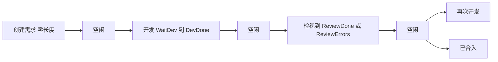

# 首页甘特图与研发分析

看板页顶栏保持不动，在「管理仓库」左侧加三个模式按钮。下面整块区域切换，用 `document.startViewTransition` 做淡入淡出（不支持或用户开启减少动效时直接切换）。顶栏的仓库多选和重要性只约束看板和甘特图。研发分析用自己的仓库下拉。

不引入甘特图库。frappe-gantt、vue-ganttastic 一类做不到：固定 5 个 24 小时列、8–12 / 14–18 工作时段底色、同一行里开发/检视/空闲反复出现、需求只画左边框、鼠标时间线。饼图和堆叠柱用 `echarts`（按需引入 pie、bar）。

## 阶段切分（甘特图和分析共用）

新模块 [shared/utils/phases.ts](shared/utils/phases.ts)，用已入库的 `issue_events.occurred_at` 加现有中文句子还原阶段。句子仍由 [shared/utils/timeline.ts](shared/utils/timeline.ts) 生成，匹配同一套文案，避免再改表。

- 需求：创建时刻为零长度，只在色块左缘画一条需求色。
- 开发：`WaitDev` / `Dev` 起，到 `DevDone` 止，整段一种颜色。还停在待开发或开发中时，右端收到当前渲染时间。
- 检视：`Review` 起，到 `ReviewDone` 或 `ReviewErrors` 止。没有检视事件（开发完直接合入）就不画检视。
- 空闲：紧跟在创建、`DevDone`、`ReviewDone`、`ReviewErrors` 之后，直到下一个状态。没有下一次动作且工单未合入时，空闲延伸到当前时间。合入（「已合入」）之后不再画。`重新打开` 之后到下一状态也算空闲。
- 检视打回后再进入 `WaitDev` / `Dev`，再画一段开发色。多次开发、多次检视在分析里各自加总。
- 从开发中直接跳到检视、或未标 `DevDone` 就合入：上一段在下个事件处结束，中间不插入空闲（空闲只出现在上述四个结束点之后）。

颜色：需求 `#f59f00`，开发 `#3b82f6`，检视 `#8b5cf6`，空闲 `#ced4da`。

[test/unit/phases.spec.ts](test/unit/phases.spec.ts) 覆盖：需求后空闲、开发整段、检视打回再开发、无检视直接合入、未结束延伸到 now、分析的「创建和完成都落在日期内」、甘特图的区间相交。

## 数据

初始查询写入起点，之后按天合并，`issues` 表里就是多日累积的全量，不会因为看板而删行。近 2 天只是看板完成列的展示裁剪。甘特图按五天窗口在全表里找交集，研发分析按查询条件在全表里统计。

现在 [server/utils/sync.ts](server/utils/sync.ts) 的 `getIssuesWithTimeline()` 在返回前丢掉关闭超过 2 天的工单，时间线也只有不带年份的句子。这个裁剪不能再用在另外两个视图上。

- `BoardIssue.timeline` 改为 `{ at: string, message: string }[]`，按 `occurredAt` 排序。[app/components/board/IssueCard.vue](app/components/board/IssueCard.vue) 的 tooltip 改读 `message`。
- 接口改为返回全部工单。「完成列只显示近 2 天」只留在看板前端，继续用 `isDoneIssueVisible`。甘特图和研发分析不走这条过滤。
- issues 表加可空列 `parent_number`（沿用 [server/utils/db.ts](server/utils/db.ts) 的 `migrateColumns`）。同步时读 GitHub 的 `parent_issue_url`，没有则看正文首行 `Part of #N`。已有库要再跑一次该仓库的「初始查询」才会补上父子关系。

## 甘特图

新组件 `app/components/gantt/GanttView.vue`。默认窗口是本地今天往前共 5 天（今天 0 点到第 5 天 24 点）。单箭头平移 1 天，双箭头平移 5 天。

纳入规则：在 issues 全表上，工单的 `[创建时间, 结束时间]` 与窗口有交集就绘制，含两天前已合入的工单。未合入的结束时间取当前时间。顶栏仓库多选和重要性先收窄，再做交集判断。

布局：任务名列初始 280px，拖动边框调整（约 160–480px），其余宽度五等分。每一天 0–24 时线性展开，8–12 与 14–18 用浅色带标出。色块画在横跨五天的同一条轨道上，才能跨日连续。窗口含今天时加一条「当前时间」细线；鼠标竖线另有开关，默认打开，在列顶显示 `MM-DD HH:mm`。

树：仓库（按 `sortOrder`）→ 工单 → 子工单。有子级才显示三角，点击折叠。工单按 number 升序（号小的在上）。父工单不在当前结果里时，子工单升到仓库下的第二级。空仓库不显示。

## 研发分析

新组件 `app/components/analysis/AnalysisView.vue`。统计范围是 issues 全表，不套看板那条「近 2 天」裁剪，也不跟顶栏仓库多选叠加。

查询条放在日期范围旁边：一个仓库下拉，默认「全部仓库」，也可以只选某一个仓库。日期只用 `UInputDate` 选起止日。点「查询」后同时按这两个条件筛选：`githubCreatedAt` 和合入时间（`githubClosedAt`）都落在该日 0 点到结束日 24 点之内，且属于所选仓库。只擦边相交的不进表。默认范围近 14 天、全部仓库，进入页面时查一次。分析区内再加任务类型筛选（feature / bug / refactor / 未分类）。顶栏重要性继续过滤这次查询结果。

`UTable` 支持行多选和表头全选，查询后默认全选。列：仓库、编号、标题、重要性、任务类型、开发时长、检视时长、空闲时长。每次勾选变化，用选中行重画：

- 饼图：选中工单的空闲、开发、检视合计。
- 堆叠柱：一根柱一个工单，自下而上空闲、开发、检视；同一工单多段先加总。

时长以小时显示。未选任何行时图表为空状态。ECharts 只在客户端 `onMounted` 里动态加载。

## 首页接法

[app/pages/index.vue](app/pages/index.vue) 用一个 `mode` 切换三块主区域，顶栏留在过渡之外。模式按钮放在现有「管理仓库」按钮左侧。SSE 补丁仍走 `useBoard`，三个视图读同一份工单列表。
