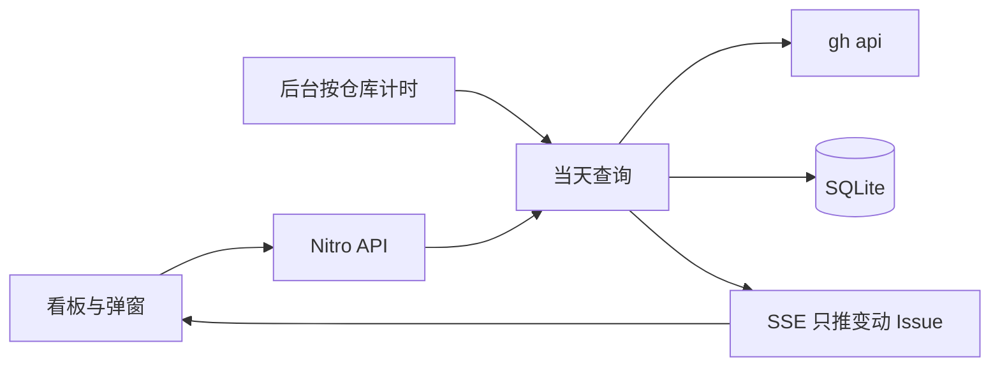

# Dev Flow Board 开发计划

空仓库（目前只有 [README.md](README.md)、[git-color.png](git-color.png)、[看板示意图.png](看板示意图.png)）。按你的选择：服务端调用本机已登录的 `gh`，不存 token；只同步 Issue 与 label，不拉 PR；生命周期用 GitHub Issue Events 回放。

固定使用 **Nuxt 4**（`app/` 为源码目录）和 **@nuxt/ui**。初始化时核对 peer：UI 4 若要求 Nuxt 5，就改用仍支持 Nuxt 4 的最新 `@nuxt/ui`。数据库用 drizzle-orm + better-sqlite3，库文件 `data/board.sqlite`（gitignore）。Nitro 跑在 Node 上，把 `better-sqlite3` 标成 external。

布局以 [看板示意图.png](看板示意图.png) 为准：顶栏加四列（需求、开发、检视、已完成），列内是仓库块，块内是任务卡片。仓库颜色只从 [git-color.png](git-color.png) 的 11 个色块里选。

## 已定规则

- 纳入条件：开放中的 Issue，且带 `Story` 或任一状态 label；已关闭的只保留带 `Merged` 的。关闭且没有 `Merged` 的不入库，同步时若库里已有则删除。Issue API 里的 PR（带 `pull_request`）直接丢掉。
- 列优先级（当前仍贴着的 label）：`closed + Merged` → 已完成；否则检视（`Review` / `ReviewDone` / `ReviewErrors`）；否则开发（`WaitDev` / `Dev` / `DevDone`）；否则仅 `Story` → 需求。同一阶段贴了多个 label 时，以最近一次 `labeled` 事件为准。`ReviewDone` 仍留在检视列，直到关闭且带 `Merged`。
- 重要性：有 `High` 为 High，否则 Low。
- 完成列只展示 `closedAt` 在近 2 天内的任务，更早的行留在库里。
- 卡片字段：`#number`、标题、描述（两行截断）、重要性、责任人（第一个 assignee，示意图里有）、开发/检视列的状态 SVG。需求列和完成列不画状态图标。
- 某列下没有任务的仓库块不渲染。仓库块按 `sortOrder` 排，块内任务 High 在前，再按 GitHub `updatedAt` 倒序。
- 生命周期文案（本地时区，`MM-DD HH:mm:ss`）：创建记「创建需求」；状态 label 的 `labeled` 记「转为 待开发/开发中/开发完成/检视中/检视成功/检视到错误」；关闭且 Merged 记「已合入」；`reopened` 记「重新打开」。重要性 label 不进时间线。
- 顶部只保留仓库筛选、重要性筛选、管理仓库、手动「刷新」。页面上没有统一定时间隔，也不再用 `localStorage` 记刷新频率。
- 每个仓库有自己的刷新间隔，在管理弹窗里设置。选项为 30 秒 / 1 分钟 / 5 分钟 / 30 分钟，默认 1 分钟。定时在服务端跑，不依赖页面开着。
- 管理仓库是看板上的弹窗，不是单独页面。保存排序、颜色或刷新间隔后，看板立刻按新配置显示，并让该仓库的后台计时改用新间隔。

## 同步与后台刷新

- 调 `gh` 用 `execFile('gh', ...)`，不经过 shell。先 `gh auth status`，没有登录或没有 `gh` 时接口返回明确错误，页面用 toast 提示。
- 仓库地址接受 `owner/repo` 或 `https://github.com/owner/repo`（可带 `.git`）。
- **初始查询**（弹窗里每个仓库一个按钮）：`gh api --paginate --slurp repos/{owner}/{repo}/issues?state=all&per_page=100`，按上面的规则整仓对账（不在纳入集合里的本地行删掉）。按钮在该行保持 loading，结束前不可重复点。
- **当天查询**：同一接口加 `since={本地当天 00:00 的 ISO 时间}`。只 upsert 这次返回且符合纳入条件的行；这次看到「已关闭且无 Merged」的删掉；没返回的行不动。
- 每个被写入的 Issue 再拉 `repos/{owner}/{repo}/issues/{n}/events`，用事件重建该 Issue 的时间线（并发约 4）。列相对库中旧值发生变化时，把 `highlightUntil` 设为现在起 60 秒；未变则不覆盖尚未到期的高亮。
- 服务启动时用 Nitro 插件为每个仓库按 `refreshIntervalMs` 排程。不在启动瞬间打 GitHub。某个仓库上一次同步还没结束就跳过这一拍。新增仓库后开始计时；删除仓库后清掉计时；修改间隔后按新间隔重新计时。插件用 `globalThis` 收口，避免开发热更新叠出多组计时器。
- 手动「刷新」对全部已登记仓库立即做一次当天查询，与定时任务走同一套合并和推送。某个仓库正在同步时，这一拍跳过。

## SSE

- `GET /api/board/stream`：页面打开后用 `EventSource` 连上，断开后重连。进程内一个小发布器，把补丁发给所有连接。Nuxt 4 / h3 的 `createEventStream` 即可，不另加依赖。
- 定时刷新和手动刷新结束后，只推这次真正变动的 Issue：新增或字段有变化的走 `upserts`（带生命周期句子和 `highlightUntil`），从库中删除的走 `deleted: [{ repoId, number }]`。没有变动就不推。
- 首次进入页面仍用 `GET /api/board` 拿全量。之后的卡片增删改只吃 SSE 补丁，用来做飞入和高亮。仓库配置（名称、颜色、排序、间隔）在保存接口的响应里直接改本地状态，不塞进 Issue 补丁。

## 数据表

- `repos`：`id`、`owner`、`name`、`fullName` 唯一、`sortOrder`、`color`、`refreshIntervalMs`（只允许 30000 / 60000 / 300000 / 1800000，默认 60000）、时间戳。
- `issues`：联合主键 `(repoId, number)`。标题、正文、open/closed、重要性、当前状态 label、列、assignee、GitHub 的 created/updated/closed、`highlightUntil`。
- `issue_events`：`(repoId, number, occurredAt, message)` 唯一，存已经写好的中文句子。

服务启动时自动建表，不要求手跑迁移。

首次建库且 `repos` 为空时插入一条测试仓库，并记下已经种过数据；用户之后删掉它，重启不再自动加回。

- 地址：`https://github.com/shenjunjian/dev-flow-board`（`shenjunjian/dev-flow-board`）
- 排序号：1
- 颜色：色板中的蓝色
- 刷新间隔：1 分钟
- 不自动做初始查询，看板在点过该仓库的「初始查询」之前是空的

## 页面与接口

单页 [app/pages/index.vue](app/pages/index.vue)，`UApp` 包在 [app/app.vue](app/app.vue)。

- `GET /api/board`：仓库、Issue、每条 Issue 的生命周期句子。筛选在前端做。
- `GET /api/board/stream`：SSE 补丁。
- `POST/PATCH/DELETE /api/repos`：增改删。字段含地址、排序号、颜色、刷新间隔。
- `POST /api/repos/:id/sync-initial`、`POST /api/sync/today`。

组件：顶栏（仓库筛选、重要性筛选、管理仓库、刷新）、四列、仓库块（边框和浅底用仓库色）、任务卡片、状态 SVG、仓库管理弹窗。弹窗里每个仓库一行：地址、排序号、[git-color.png](git-color.png) 的 11 色（上排黑红绿蓝橙紫，下排灰黄浅绿浅蓝粉，选中态加圈）、刷新间隔、初始查询、删除。悬停卡片用 `UTooltip` 按时间顺序列出生命周期。

列切换动画：应用 SSE 补丁前记下每张卡片的位置，更新后对「列变了且旧位置还在」的卡片做 FLIP 飞入；`highlightUntil` 未过期时高亮边框约 1 分钟。首次加载不飞。

状态图标：`WaitDev` 静态沙漏；`Dev`、`Review` 用 SVG 动画表示进行中；`DevDone` 用高对比勾；`ReviewErrors` 用高对比警示；`ReviewDone` 用较平静的成功勾。

列与 label 的纯函数放在 `shared/`，用 Vitest 覆盖优先级、同一阶段多个 label、关闭无 Merged 被排除、完成列 2 天窗口。不给 `gh` 做集成测试。

README 末尾补一段本地运行说明：Node 22、`gh auth login`、安装依赖、`npm run dev`。说明定时刷新在服务端按仓库间隔运行。

## 实现时自检

浏览器里走通：新增/编辑/删除仓库后排序和颜色立刻反映到看板；每个仓库能改刷新间隔；筛选；手动刷新；页面不设统一定时器；后台到期后只收到变动 Issue，列切换有飞入和高亮；`gh` 不可用时有错误提示；卡片 tooltip；完成列不出现超过 2 天的任务。用种子仓库 `shenjunjian/dev-flow-board` 点一次初始查询，确认能写入并出现在看板上。
