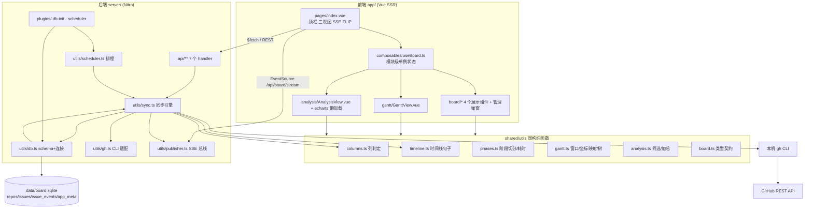
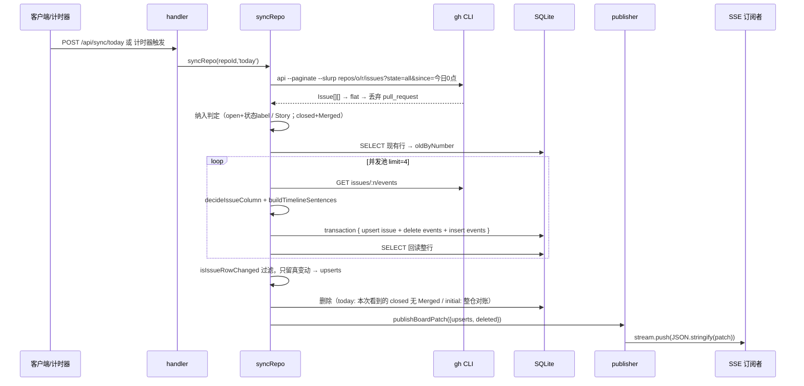

# dev-flow-board 源码解析

> 分析对象：当前工作区 `D:\WORK\dev-flow-board`（分支干净，源码总量约 4050 行 TS/Vue）。
> 覆盖：后端服务层、SQLite 数据表、前端页面架构，以及贯穿三端的数据流。

---

## 0. 先校正一个技术栈事实

README 与代码显示，本项目**不是 NestJS**，而是 **Nuxt 4 全栈应用**：

| 维度 | 本项目实际 | NestJS 里的对应物 |
| --- | --- | --- |
| 框架 | Nuxt 4（`app/` 前端）+ **Nitro**（`server/` 后端） | `@Module` + `@Controller` + `@Injectable` |
| 路由 | 文件路由 `server/api/**`，导出 `defineEventHandler` | HTTP method decorator |
| 依赖注入 | 无 DI 容器，靠 ES Module 直接 import + `globalThis` 单例 | `@Injectable()` Provider |
| ORM | Drizzle ORM + `better-sqlite3`（同步 API） | TypeORM / Prisma |
| 定时任务 | Nitro plugin + 原生 `setInterval` | `@nestjs/schedule` |
| 实时推送 | SSE（`createEventStream`） | `@nestjs/platform-socket.io` / RxJS |
| 前端 | Vue 3 SFC + Nuxt UI v4 + Tailwind CSS 4 + ECharts 6 | ——（Nest 通常不含前端） |

因此下文所说的"后端"，指 **Nitro Server 层**；它的组织方式确实是"Controller → Service → Repository"味道，只是用目录约定而非装饰器实现。

---

## 1. 项目总览

一句话：**用本机已登录的 `gh` CLI 轮询若干 GitHub 仓库的 Issue，按 label 推断研发状态，落到本地 SQLite，再通过 SSE 增量推给一个三视图（看板 / 甘特图 / 研发分析）单页。**

### 1.1 目录结构

```
dev-flow-board/
├── nuxt.config.ts            # Nuxt/Nitro 装配：@nuxt/ui、关字体优化、better-sqlite3 外部化
├── app/                      # 前端（Vue SSR 应用）
│   ├── app.vue               # UApp + 中文 locale 外壳
│   ├── app.config.ts         # 覆写全站 tooltip 主题为深色
│   ├── assets/css/main.css   # Tailwind 入口 + ViewTransition 过场动画
│   ├── pages/index.vue       # 唯一路由页：顶栏 + 三视图切换 + SSE + FLIP
│   ├── composables/useBoard.ts  # 模块级单例状态中枢
│   └── components/
│       ├── board/            # BoardColumn / RepoBlock / IssueCard / StatusIcon / RepoManagerModal
│       ├── gantt/GanttView.vue
│       └── analysis/         # AnalysisView.vue + load-echarts.ts（按需注册）
├── server/                   # 后端（Nitro）
│   ├── api/                  # 7 个端点（Controller 层）
│   ├── utils/                # db / gh / sync / scheduler / publisher / serialize（Service 层）
│   └── plugins/              # db-init / scheduler（启动钩子）
├── shared/utils/             # 前后端同构纯函数（列判定、阶段切分、甘特/分析算法）
├── test/unit/                # 9 个 vitest 用例，只覆盖 shared 纯函数
├── data/board.sqlite         # 运行时数据库（gitignore）
└── demos/ skills/ .cursor/   # 与主流程无关的脚本、技能文档、计划稿
```

### 1.2 分层架构



设计上有价值的一点：**状态语义只有一份真源**。`shared/utils/columns.ts` 的 label→列映射被后端 `sync.ts` 用来落库、被前端 `BoardColumn.vue` 用来裁剪完成列、被 `phases.ts`→甘特/分析用来算耗时，不会出现"前端显示一列、后端存另一列"的漂移。

---

## 2. 后端解析（Nitro Server 层）

### 2.1 Controller 层：`server/api/**`

7 个端点，命名即语义，全部返回**普通 JSON**（错误走 `{ error }` 字段或 `createError`）：

| 方法 + 路径 | 文件 | 职责 | 关键点 |
| --- | --- | --- | --- |
| `GET /api/board` | `board/index.get.ts` | 首屏全量：仓库（按 `sortOrder`）+ 全部 Issue（内联时间线） | 筛选不在服务端做，全交给前端 |
| `GET /api/board/stream` | `board/stream.get.ts` | SSE 长连接 | `createEventStream` + `subscribeBoardPatches`，`onClosed` 里退订 |
| `POST /api/sync/today` | `sync/today.post.ts` | 顶栏"刷新"：全仓当天查询 | `Promise.all` 并发，逐仓返回 `{ok,error,upserted,deleted}` |
| `POST /api/repos` | `repos/index.post.ts` | 新增仓库 | 四段手写校验 → 唯一性 → `gh auth status` 预检 → 插入 → `scheduleSingleRepo` |
| `PATCH /api/repos/:id` | `repos/[id].patch.ts` | 改地址/排序/颜色/间隔 | 地址变了就**事务清空**该仓 Issue 与事件，让用户重跑初始查询 |
| `DELETE /api/repos/:id` | `repos/[id].delete.ts` | 删仓 | 事务删 issues + events + repo，再 `unscheduleRepo` |
| `POST /api/repos/:id/sync-initial` | `repos/[id]/sync-initial.post.ts` | 整仓初始查询 | 失败抛 `409`，错误文案直接是 `GhError.message` |

值得注意的两种错误风格并存：管理端点用 `{ error: string }` 返回值（让弹窗能逐行 toast、不中断整批保存），`sync-initial` 用 `createError` HTTP 状态码（前端只需一次失败提示）。这不是不一致，而是被调用方的 UX 决定的。

### 2.2 外部依赖适配：`utils/gh.ts`

整个项目**不保存 GitHub token**，全部通过子进程调用已登录的 `gh`：

```ts
const { stdout } = await execFileAsync('gh', args, { maxBuffer: MAX_BUFFER }) // 64MB
```

三个细节都是实用的：

1. `execFile` 而非 `exec`/shell —— 免掉注入与 quoting 问题，参数数组直传；
2. `MAX_BUFFER = 64MB` —— 因为 `--paginate --slurp` 拉整仓 Issue 时输出是一个"数组的数组"，默认 1MB 会爆；
3. `toGhError()` 把底层错误翻译成人话并分类：`ENOENT` → "未找到 gh 命令"，有 `stderr` → 取第一行，否则兜底。自定义 `GhError` 的 `message` 就是可以直接展示给用户的文案，服务端因此不用二次映射错误码。

`checkGhAuth()` 在新增仓库前跑 `gh auth status`，把"环境没准备好"提前到写库之前暴露。

### 2.3 数据访问：`utils/db.ts`

见第 3 节（与数据表设计一起讲）。对外只有一个入口 `useDb()`，返回 `{ sqlite, db }`：`db` 是 Drizzle（写查询），`sqlite` 是原始连接（只为拿 `sqlite.transaction()`）。

### 2.4 DTO 映射：`utils/serialize.ts`

`toBoardRepo` / `toBoardIssue` 把 Drizzle 行（`Date` 对象、snake_case 列名）转成 `BoardIssue`（ISO 字符串、camelCase）。所有时间**统一序列化为 ISO**，前端再本地化展示。这一层是服务端与前端之间唯一的形状约定处，`shared/utils/board.ts` 提供类型契约，因此前后端字段永远同步（TS 编译期就锁死）。

### 2.5 同步引擎：`utils/sync.ts`（全项目最核心的 367 行）

#### 入口与互斥

```ts
export async function syncRepo(repoId, mode) {
  if (syncingRepos().has(repoId)) return { ok:false, error:'该仓库正在同步中，本拍跳过' }
  syncingRepos().add(repoId)
  try { return await syncRepoInner(repo, mode) } finally { syncingRepos().delete(repoId) }
}
```

互斥集合挂在 `globalThis.__devFlowBoardSyncing` 上 —— 这是本项目反复出现的惯用法（`db.ts`、`publisher.ts`、`scheduler.ts` 都一样）。**原因**：Nitro 在 dev 下会热重载 server 模块，模块级状态会随重载重置、造成同一仓库叠加多个计时器/多份连接；把状态收口到 `globalThis` 后，热更新只重建代码、不重建状态。

#### 一次同步的完整流程



#### 纳入规则（决定"哪些 Issue 值得进库"）

```ts
if (issue.state === 'closed') {
  if (names.has('Merged')) included.push(issue)   // 已合入 → 进完成列
  else closedNoMerged.push(issue)                 // 手动关闭 → 排除，且触发删除
} else {
  const hasStatus = [...names].some(n => STATUS_LABEL_STAGES[n])
  if (names.has('Story') || hasStatus) included.push(issue)
}
```

即：开放 Issue 至少带一个状态 label 才纳入；关闭 Issue 只有带 `Merged`（PR 真正合入，线下人工贴的标记）才纳入。README 明确要求"已关闭无 label 的不记录"，这里实现的是"关闭无 Merged 的不仅不记录、还要从库里删"。

#### 列判定 tie-break：为什么还要拉 events

`decideIssueColumn` 的优先级是 `检视 > 开发 > 需求`。但同一个 Issue 上可能同时残留 `Dev` 和 `Review` 两个 label（团队忘了撕旧 label）。这时光看当前 label 无法判断，于是同步时额外拉 `issues/:n/events`，用 `buildLatestLabeledAt()` 收集每个状态 label **最近一次 `labeled` 的时间**，谁的 `labeled` 更晚谁作数：

```ts
const decision = decideIssueColumn({
  state: issue.state,
  labels: names,
  latestLabeledAt: buildLatestLabeledAt(events),   // ← tie-break 数据源
})
```

同一次 events 拉取还有第二个用途：喂给 `buildTimelineSentences` 生成生命周期文案（存 `issue_events`）。**一份外部请求，两个消费者**，这是 `EVENTS_CONCURRENCY = 4` 并发池存在的理由（否则每张工单要单独再拉一次）。

单事件拉取失败只 `console.warn` + 返回空数组，不阻断整仓同步 —— 可用性优先于完整性。

#### 高亮语义：只在"换列"时点亮 60 秒

```ts
const columnChanged = !old || old.column !== decision.column
if (columnChanged) highlightUntil = new Date(now + HIGHLIGHT_MS)   // 60_000
else if (old?.highlightUntil && old.highlightUntil.getTime() > now) highlightUntil = old.highlightUntil
```

未换列时**保留未到期的高亮**，不被后续轮次覆盖清零；到期后写 `null`。

#### 变更检测：`isIssueRowChanged`

为了"只推真正变动的 Issue"，逐字段比对 12 个字段（title/body/state/importance/taskType/statusLabel/column/assignee/parentNumber/created/updated/closed + highlight）。其中一条特例很讲究：

```ts
// 旧值已过期、新值为 null：自然过期，不算变动
if (oldHighlight !== null && nextHighlight === null && oldHighlight <= Date.now()) return false
```

否则每 60 秒高亮到期都会把整表推一遍，SSE 变成心跳噪声。

#### 事务与"写后回读"

每张工单一个事务：`upsert`（`onConflictDoUpdate` 联合主键）+ 时间线**整组重写**（先 `delete` 再 `insert`，比 diff 简单且幂等）。之后重新 `SELECT` 回整行再序列化，确保推给前端的对象与库里存的一致（例如 `Date` 精度、默认值由 DB 决定的字段）。

#### 两种模式的删除策略差异（`initial` 与 `today` 的本质区别）

```ts
if (mode === 'today') { for (const i of closedNoMerged) numbersToRemove.add(i.number) }
else { const includedNumbers = new Set(included.map(i => i.number))
       for (const row of oldRows) if (!includedNumbers.has(row.number)) numbersToRemove.add(row.number) }
```

- `today` 是**增量**：只删这次亲眼看到"关闭且无 Merged"的行，这次没返回的历史行不动 —— 因为 `since=今日0点` 本来就只返回今天活跃的行；
- `initial` 是**对账**：以"纳入集合"为准，库里所有不在集合内的行全部删掉。

这正是 README 里"重复执行初始查询或当天查询，都是将查询结果与本地 SQLite 记录做一次合并"的实现落地。

> 注意一个刻意的取舍：`sync.ts` 把**全表变动**都推给 SSE，"完成列只显示近 2 天"的裁剪放在前端 `BoardColumn.vue` 做。原因是同一份补丁要同时服务三个视图，而甘特图和研发分析**需要**看 2 天以前已合入的工单。

### 2.6 排程与广播

`utils/scheduler.ts`：`Map<repoId, {timer}>`，按每个仓库自己的 `refresh_interval_ms` 各自 `setInterval`。

- **首拍延后**：`setInterval` 天然在一个间隔后才触发，启动瞬间不打 GitHub（与 plugin 注释一致）；
- `timer.unref?.()`：不阻止进程退出；
- `rescheduleAll()`：全量重读 DB → 清掉已删仓库的计时 → 全部重排（改间隔即重新计时）；
- `scheduleSingleRepo()` / `unscheduleRepo()`：增删改后单点调整。

**关键架构决定**：定时刷新在**服务端**按仓库排程，与"页面是否打开"无关。所以关掉浏览器 Issue 照样入库，重新打开页面用 `GET /api/board` 拿到历史。顶栏那个"定时刷新"下拉在服务端只是配置项，前端不再有轮询计时器。

`utils/publisher.ts`：一个 `Set<(patch) => void>` 的进程内总线。`publishBoardPatch` 遇到空补丁直接 return；单个订阅者抛错被 `try/catch` 吞掉，不影响其他连接。SSE handler 只负责把 `fn` 注册进去、`onClosed` 时注销 —— 广播与传输解耦，日后换 WebSocket 只改 `stream.get.ts`。

---

## 3. 数据表设计

### 3.1 建库链路（`createDb()`）

```ts
mkdirSync(DATA_DIR, { recursive: true })
const sqlite = new Database(DB_PATH)          // data/board.sqlite
sqlite.pragma('journal_mode = WAL')           // 读写并发
sqlite.pragma('foreign_keys = ON')            // SQLite 默认不开 FK，必须显式开
sqlite.exec(DDL)                              // CREATE TABLE IF NOT EXISTS ×4
migrateColumns(sqlite)                        // 轻量加列
const db = drizzle(sqlite)
seedOnFirstRun(db)                            // 首建库写种子仓库
```

`DDL` 是**手写的**、与 Drizzle schema 一一对应的 SQL 常量（文件注释也这么声明）。项目没有用 `drizzle-kit` 迁移文件，换来的是"启动即建表、零运维"，代价是 schema 存在两份表达、需人工保持一致（`issue_events` 的 `uniqueIndex` 就分别写在 schema 和 DDL 两处）。

### 3.2 四张表

#### `repos` — 仓库配置（看板块的渲染源）

| 列 | 类型 | 约束/默认 | 用途 |
| --- | --- | --- | --- |
| `id` | INTEGER | PK AUTOINCREMENT | 内部主键 |
| `owner` / `name` | TEXT | NOT NULL | 拼 `gh api repos/{owner}/{name}/...` |
| `full_name` | TEXT | NOT NULL **UNIQUE** | 业务唯一键，新增/改名前的重复检查 |
| `sort_order` | INTEGER | NOT NULL DEFAULT 0 | 看板列内仓库块的渲染顺序 |
| `color` | TEXT | NOT NULL DEFAULT `#1971c2` | 边框色 + `色值+1a` 的浅背景 |
| `refresh_interval_ms` | INTEGER | NOT NULL DEFAULT 60000 | 服务端排程间隔，白名单 30s/1m/5m/30m |
| `created_at` / `updated_at` | INTEGER | NOT NULL, `timestamp_ms` | 审计 |

#### `issues` — 工单当前状态（联合主键 `repo_id + number`）

| 列 | 类型 | 说明 |
| --- | --- | --- |
| `repo_id` | INTEGER NOT NULL | FK → `repos.id` **ON DELETE CASCADE** |
| `number` | INTEGER NOT NULL | GitHub Issue 号；与 `repo_id` 组成 `PRIMARY KEY` |
| `title` / `body` | TEXT / TEXT | 卡片正文（body 前端 `line-clamp-2`） |
| `state` | TEXT NOT NULL | `open` / `closed`（GitHub 原始语义） |
| `importance` | TEXT NOT NULL DEFAULT 'low' | 由 `High` label 推出；无 label 默认 low |
| `task_type` | TEXT | `feature` / `bug` / `refactor` / NULL（可空扩展列） |
| `status_label` | TEXT | 当前**生效**的状态 label（tie-break 之后） |
| `board_column` | TEXT NOT NULL | `story` / `dev` / `review` / `done`，落库的列归属 |
| `assignee` | TEXT | 只取 `assignees[0]`（一人主责的简化） |
| `github_created_at` / `github_updated_at` | INTEGER NOT NULL | 排序、甘特窗口判断用 |
| `github_closed_at` | INTEGER | 完成列 2 天裁剪 & 甘特右端 |
| `highlight_until` | INTEGER | 换列后的高亮截止时间戳 |
| `parent_number` | INTEGER | 父工单号，甘特树第三级 |

联合主键 `(repo_id, number)` 直接实现了 README"用仓库名称+issueNumber 做联合主键"的要求，同时是 `onConflictDoUpdate({ target: [repoId, number] })` 的 upsert 锚点。用 `repo_id`（代理键）而不是 `full_name`（业务键）做外键列，好处是仓库改名不会破坏 Issue 关联 —— 但项目选择了更激进的行为：改地址就清空该仓 Issue（见 PATCH handler），因为旧 Issue 对新仓库毫无意义。

#### `issue_events` — 生命周期流水（tooltip 与甘特/分析的共同数据源）

| 列 | 类型 | 说明 |
| --- | --- | --- |
| `id` | INTEGER PK AUTOINCREMENT | 同秒事件的稳定排序兜底 |
| `repo_id` / `number` | INTEGER NOT NULL | 逻辑关联（**没有 FK**，由同步代码手工删除维护） |
| `occurred_at` | INTEGER NOT NULL | 事件时间 |
| `message` | TEXT NOT NULL | **已渲染好的中文句子**，含 `MM-DD HH:mm:ss` 前缀 |

唯一索引 `issue_events_unique (repo_id, number, occurred_at, message)` 保证重复同步不会积累重复行。

这里有一个耐人寻味的建模决定：**存句子，不存结构化事件**。字段名叫 `message`，内容像 `10-15 12:35:18 转为 待开发`。收益是 tooltip 直接 `{{ entry.message }}` 渲染、后端 `splitPhases()` 用 `message.endsWith(...)` 反解阶段，一次拉取一份文本同时喂两个视图；代价是阶段算法与文案耦合（`classify()` 依赖 `STATUS_LABEL_TEXT` 常量而非硬编码字符串，算是把风险收口了），且改文案会让历史数据失去语义。

#### `app_meta` — 键值元信息

只有 `key` / `value`，当前唯一用途是 `seeded` 标记：首次建库写入种子仓库 `shenjunjian/dev-flow-board`，此后**用户删掉该仓库也不会自动加回**（README 明确要求）。

### 3.3 迁移策略：`migrateColumns()`

```ts
const hasColumn = (t, c) => sqlite.pragma(`table_info(${t})`).some(x => x.name === c)
if (!hasColumn('issues', 'task_type'))     sqlite.exec('ALTER TABLE issues ADD COLUMN task_type TEXT')
if (!hasColumn('issues', 'parent_number')) sqlite.exec('ALTER TABLE issues ADD COLUMN parent_number INTEGER')
```

`CREATE TABLE IF NOT EXISTS` 对已存在的旧库不会补新列，所以这里做一次"缺列就补"的幂等迁移。轻量、无版本表，适合个人工具级项目；一旦改动列类型或需要数据回填，这套机制就会不够用。

我在实际库里验证了它真的跑过：`issues` 表里 `task_type`、`parent_number` **排在 DDL 声明顺序之后**（`...highlight_until, task_type, parent_number`），正是 `ALTER TABLE` 追加的特征，说明这个库是在这两个列加入之前建的。

### 3.4 当前库内快照（实测）

```
repos          1 行  shenjunjian/dev-flow-board  sort=1 color=#2f9e44 interval=60000
issues         8 行  story 2 / dev 3 / review 1 / done 2
issue_events  32 行  例：#3  创建需求 12:35:16 → 转为 待开发 12:35:18
                        → 转为 检视中 12:48:12 → 已合入 13:20:46
```

`status_label` 分布也印证了规则：两条 `done` 行的 `status_label` 为 `null`（完成列不画状态图标），三条 `WaitDev`/`ReviewDone` 行带 label，`task_type` 分别有 `bug` / `feature` / `refactor` / `null`。

---

## 4. 前端页面架构

### 4.1 应用外壳与渲染策略

- `app.vue`：`<UApp :locale="zh_cn"><NuxtPage /></UApp>`，Nuxt UI 的 toast/overlay 上下文由此提供。
- `app.config.ts`：在**主题层**整串覆写 `tooltip` 的 slots（`bg-neutral-900` + 白字 + 深色箭头），因为默认浅色主题贴在看板上对比不足。注释还解释了两处坑：`text` 属性渲染的是 `nowrap` 单行 span（`\n` 不换行）、主题自带 `h-6` 会裁多行，所以改用 `#content` 插槽 + 靠 `twMerge` 用 `h-auto` 顶掉。
- **SSR 策略**：全站只有 `pages/index.vue` 一个路由，数据在 `onMounted` 才拉。`useBoard.ts` 的注释写得很清楚 —— 模块级 ref 在服务端渲染时恒为初始空值，因此跨请求共享是安全的。这是一个"故意不做 SSR 数据预取"的取舍，避免了 Hydration 与 SSE 时序纠缠，代价是首屏会闪一次骨架。
- `nuxt.config.ts` 三处与架构直接相关：`ui.fonts: false`（本机访问不到 fonts.google.com，否则启动反复超时）、`components.pathPrefix: false`（`board/` 子目录组件保持 `RepoBlock` 原名，模板里才写成 `<BoardColumn>` / `<GanttView>` 混用形态）、`nitro.externals.external: ['better-sqlite3']`（原生模块不能打包）。

### 4.2 状态中枢：`composables/useBoard.ts`

不是 `useState`/Pinia，而是**模块顶层的 `ref`** —— 天然进程内单例，让页面与"仓库管理弹窗"共享同一份 `repos` / `issues`，无需 props 穿透或事件总线。

```ts
const repos = ref<BoardRepo[]>([])
const issues = ref<BoardIssue[]>([])
const repoFilter = ref<number[]>([])                      // 空数组 = 全部
const importanceFilter = ref<'all'|'high'|'low'>('all')
const now = ref(Date.now())                               // 每秒 tick，驱动高亮过期
if (import.meta.client) setInterval(() => (now.value = Date.now()), 1000)
```

`now` 这个"1Hz 心跳"是纯前端现象：`highlightUntil` 是绝对时间，只有让它每秒重算一次，60 秒后卡片上的黄色 ring 才会自己摘掉。

暴露的 API 分四组：

| 组 | 成员 | 说明 |
| --- | --- | --- |
| 状态 | `repos` `issues` `repoFilter` `importanceFilter` `filteredIssues` `loading` `refreshing` `now` | `filteredIssues` 是唯一的 computed 筛选（仓库 + 重要性） |
| 拉取 | `load()` | `GET /api/board` 全量 |
| 变更 | `refresh()` | `POST /api/sync/today` + 分组 toast（失败列表 / 变动条数 / 空提示） |
| 补丁 | `applyPatch(patch)` | `deleted` 建 Set、`upserts` 建 Map，`kept + upserts` 一次替换数组 |
| 仓库 | `applyRepos` / `upsertRepo` / `removeRepo` | 保存后本地立即排序并清理孤儿 Issue 与失效筛选 |

`applyPatch` 用 `key = ${repoId}-${number}` 做身份，与后端联合主键同构；整数组替换（而不是原地 mutate 元素）让 Vue 的 `v-for` diff 直接命中 key。

`applyRepos` 里有个防御细节：仓库被删后，同步清掉 `repoFilter` 中已不存在的 id，并丢掉该仓库的 Issue —— 否则筛选下拉会出现幽灵选项。

### 4.3 首页骨架：三视图 + ViewTransition

```
<div class="flex h-screen flex-col overflow-hidden">
  header   标题 · 仓库多选(USelectMenu) · 重要性(USelect) · 视图 tab · 管理仓库 · 刷新
  main.mode-stage[data-mode]   v-if loading → USkeleton
                               board   → 4×BoardColumn
                               gantt   → GanttView
                               analysis→ AnalysisView
  RepoManagerModal（v-model:open）
```

视图切换的实现值得细看：

```ts
function setMode(next) {
  const reduceMotion = window.matchMedia('(prefers-reduced-motion: reduce)').matches
  const start = document.startViewTransition?.bind(document)
  if (!start || reduceMotion) { mode.value = next; return }   // 双重降级
  start(() => { mode.value = next; return nextTick() })       // 等 DOM 刷完再截新画面
}
```

配套 CSS（`app/assets/css/main.css`）把 `root` 快照动画关掉，只给 `.mode-stage` 设 `view-transition-name`，做 180ms 的交叉淡入淡出。**顶栏不在 `.mode-stage` 内**，所以切换视图时顶栏纹丝不动 —— 精确实现了"保持顶部不变、下面区域整体切换"。三块视图读同一份工单数组，切换零成本、无重复请求。

注意 README 曾建议可用 Motion 库，实际选了原生 ViewTransition + 纯 CSS，零依赖，且自带可访问性降级。

### 4.4 看板视图：四级组件树

```
BoardColumn (column, repos, issues, now)
  └─ RepoBlock (repo, issues, now)
       └─ IssueCard (issue, repo, now)
            ├─ StatusIcon (status)
            └─ UTooltip #content → timeline[].message
```

| 组件 | 核心逻辑 |
| --- | --- |
| `BoardColumn.vue` | 列内二次筛选：`column` 匹配 + **完成列**走 `isDoneIssueVisible(closedAt, now)`（近 2 天）；`blocks` 过滤掉没有任务的仓库块（空块不渲染）；标题带计数徽标 |
| `RepoBlock.vue` | 排序 `High` 优先、再按 GitHub `updatedAt` 倒序；颜色 `borderColor: repo.color` + `backgroundColor: color + '1a'`（**直接拼 inline style**，注释点明是为了绕开 Tailwind 动态类被 purge）；仓库名外链到新标签页 |
| `IssueCard.vue` | `#编号` 大字 + 标题外链 + 任务类型徽标（feature 蓝 / bug 红 / refactor 琥珀）+ High 实底红；`highlighted` 由 `highlightUntil > now` 驱动，样式是 `border-warning ring-2 ring-warning/40`；**状态图标只在 `dev`/`review` 列画**（需求列与完成列无状态）；tooltip 用插槽逐条渲染时间线 |
| `StatusIcon.vue` | 六个手写 SVG：`WaitDev` 沙漏（静态）、`Dev` 旋转弧、`Review` 放大镜巡行、`DevDone` 实心绿圆白勾、`ReviewErrors` 红三角白叹号、`ReviewDone` 平静描边勾 |

`Review` 图标的动画实现很讲究：不做 `rotate`，而是用 12 个 `translate()` 关键帧（每 30° 采样圆周，半径 4.5px）让放大镜**平移巡圆**，镜片姿态恒定（手柄始终朝右下），像举着放大镜扫查；注释还算了账——20px 尺寸下 30° 折线与圆弧偏差 <0.15px，肉眼看不出。外加 `overflow: visible` 防止最外点描边被 viewBox 裁掉，`prefers-reduced-motion` 下停在轨迹顶端。

### 4.5 FLIP 飞行动画：列切换时的位移补偿

`index.vue` 的 `handlePatch` 是全项目最"手工"的一段，也是"任务飞过去 + 高亮 1 分钟"的落地：

```ts
const before = snapshotCardRects()                 // F: 遍历 [data-card] 记 getBoundingClientRect
const oldColumns = new Map(issuesByKey().map(i => [`${i.repoId}-${i.number}`, i.column]))
applyPatch(patch)                                  // 状态更新
const movedKeys = new Set()                        // 只挑「列变了」的卡（新出现的卡不飞）
for (const up of patch.upserts) {
  const key = `${up.repoId}-${up.number}`
  if (oldColumns.get(key) !== undefined && oldColumns.get(key) !== up.column) movedKeys.add(key)
}
nextTick(() => flipMovedCards(before, movedKeys))  // L: 读新 rect → I: 差值 → P: 过渡回 0
```

`flipMovedCards` 里三处细节都是 FLIP 的标准难点：位移 <1px 跳过（避免无意义动画）；先 `transition = 'none'` 再设 `transform` 偏移，然后 `void el.offsetWidth` **强制 reflow**，最后才挂 0.45s `cubic-bezier(0.22,1,0.36,1)` 过渡回 `transform: ''`；`transitionend` 一次性清掉内联 transition，避免污染后续样式。

高亮（1 分钟提醒）与飞行（450ms）是两条独立机制：前者由服务端写 `highlight_until` + 前端 `now` tick 驱动，后者纯客户端几何补偿。这样即使 SSE 断连、高亮仍在下一次全量加载后正确显示。

### 4.6 实时链路：SSE 客户端

```ts
source = new EventSource('/api/board/stream')
source.onmessage = ev => { try { handlePatch(JSON.parse(ev.data)) } catch {} }  // 忽略坏帧
source.onerror   = () => { if (source?.readyState === EventSource.CLOSED) scheduleReconnect() }
```

浏览器原生 `EventSource` 会自动重连，这里再加一层 5 秒兜底重建（只在彻底 `CLOSED` 时）。`onBeforeUnmount` 关连接并清计时器。注意**前端不做轮询**：README 里那个"30 秒/1 分/5 分/30 分"的下拉，实际语义是**每个仓库的服务端排程间隔**（在管理弹窗里逐仓设置），页面上没有统一定时器。

### 4.7 仓库管理弹窗：整表编辑 → 批量 diff 提交

`RepoManagerModal.vue` 不是"改一行调一次接口"，而是一个**伪离线**的表格编辑器：

1. 打开时把 `repos` 拷成 `rows: RepoRow[]`，每行带 `rowId`（新行用 `tempSeq--` 的**负数临时 id**，与真实正数 id 天然不冲突）；
2. 新增/编辑一律走 `POST` / `PATCH`，逐行提交，任一行失败只 toast 不中断整批；
3. **删除靠集合差**：本轮 `aliveIds` 里没出现的原有仓库，逐个 `DELETE`；
4. 每次成功都用 `upsertRepo(res.repo)` 把响应直接写回单例状态，所以保存完看板立即反映新排序与新颜色；
5. `syncing` 是行内字段，让"初始查询"按钮在**该行**独立 loading，不重复点。

`UInput` 绑 `v-model="row.original.address"` 能直接落到 `rows`，注释解释了原理：Vue 响应式是代理不是克隆，`row.original` 就是 `rows` 里那个对象。还有一个很真实的坑记录在模板注释里——含 `https://` 的长中文 placeholder 会触发 vue-tsc 解析 bug 并把插槽作用域整个报崩，所以文案必须用短地址形态 `'owner/repo'`。

### 4.8 甘特视图：自绘 + 纯函数内核

README 让"优先找开源甘特组件，没有就自绘并回头讨论"。实际选择是**自绘**——因为需求里"工作时段浅色带 / 每工单多阶段色块 / 未结束段截到当前时间 / 树形三级折叠 / 可拖列宽 / 鼠标时间线"这些组合，通用甘特库很难全覆盖，而自绘只需一个 CSS Grid + 百分比定位。

复杂度被完全推到 `shared/utils/gantt.ts`（226 行）与 `phases.ts`（186 行），`GanttView.vue` 只做绑定：

| 纯函数 | 职责 |
| --- | --- |
| `defaultGanttWindowStart(now)` | 本地今天往前共 5 天，含今天（`startOfLocalDay(now) + (1-5)` 天） |
| `ganttDays(start)` | 生成 5 个日的 `{start,label,weekday}` |
| `timeToRatio(ms, windowStart)` | 时间 → 轨道 0–1：每天占 1/5，天内按本地 0–24 线性展开；窗口外夹到 0/1 |
| `ratioToTime(ratio, windowStart)` | 反函数，给鼠标提示线换算时刻 |
| `buildGanttTree(repos, issues, windowStart, now)` | 窗口相交筛选 → 按 `sortOrder` 分仓 → `buildIssueForest` 靠 `parentNumber` 建树（父不在这批里则子升到仓库下，`placed` 防环，孤儿兜底追加） |
| `ganttMarks(timeline, windowStart, now)` | `splitPhases` → 裁到窗口内 → 转成 `{kind,startRatio,endRatio}` |

`splitPhases()` 是整个甘特/分析的算法心脏：把**中文时间线句子**反解为 `Phase{kind,start,end}` 序列，规则严格对齐 README：

- `story` 是**零长度**段（`start === end`），所以图上只画 0.5px 的左边界色条；
- `WaitDev`/`Dev` 都归 `dev-start`，同一次开发内的两段**合并成一段**；
- `DevDone`/`ReviewDone`/`ReviewErrors`/`reopened` 之后才进入 `idle`；`Dev → Review` 直接衔接，中间不插空闲；
- `merged` 之后停止绘制，直到 `reopened`；
- 未闭合的最后一段右端收到 `now`（"开发中的块每次渲染都截到当前时间"）；
- 同一时刻多事件用 `MARK_RANK` 排序，保证"先收束上一段，再开下一段"。

`rangesOverlap()` 对半开区间和零长度点做了显式处理（点落在区间内算相交、端点相接不算），`issueOverlapsWindow()` / `isCreatedAndClosedInRange()` 分别是甘特与分析的纳入口径 —— 两者**故意不同**：甘特取"与窗口有交集"，分析取"创建和合入都落在范围内"（只擦边的必须扩大日期范围才统计，README 明写）。

组件侧的交互全在几十行里：`shift(±1/±5)`（单箭头/双箭头）、`collapsed: Set<string>`（`repo:`/`issue:` 前缀做 key，切换时**新建 Set** 以触发响应式）、`pointerdown` + `setPointerCapture` 的列宽拖拽（`clampNameWidth` 限 160–480，拖拽期间 `select-none`）、`mousemove` 算 `hoverRatio`（减去 `nameWidth` 再除轨道宽），以及 `GANTT_WORK_BANDS`（8–12、14–18 的 `bg-inverted/5` 浅色带）。当前时间线只在 `windowIncludesToday` 为真时画红色竖线。

竖线定位有个 `calc()` 技巧：外层线覆盖整块，需 `calc(${nameWidth}px + (100% - ${nameWidth}px) * ratio)`；行内元素在日期区容器内，直接用 `left: ratio*100%`。悬停时刻的标签还会按 ratio 在 <0.08 / >0.92 时切换 `translateX`，避免贴边溢出。

### 4.9 研发分析视图：表格多选驱动 ECharts

`AnalysisView.vue`（541 行，最大的组件）三段式布局：筛选条 → 结果表 → 图表区。

**筛选与统计的时序被人为分成两层**：`applied`（点"查询"才快照的 `{start,end,repoId}`）与 `taskFilter` / `assigneeFilter`（下拉即生效）。这样"查询"控制重口径的日期/仓库，而类型、责任人做即时二次过滤，不必反复点按钮：

```ts
queriedIssues = filterAnalysisIssues(props.issues, query.start, query.end, query.repoId)  // 依赖 applied
displayedRows = buildAnalysisRows(queriedIssues.filter(task && assignee 匹配), repos, Date.now())
```

`buildAnalysisRows` 里对每行调 `analysisDurations(timeline, now)` → `splitPhases` → `sumPhaseDurations`，把多段开发/检视/空闲**分别加总**再换成小时，正是 README 要求的口径。

表格用 `UTable` + `rowSelection`（v-model），全选/半选由 TanStack 的 `table.getIsAllPageRowsSelected()` 驱动（列定义里用 `h(UCheckbox, ...)` 渲染，故需 `resolveComponent('UCheckbox')`）。**查询后默认全选**（`runQuery` 里把 `displayedRows` 全部置 `true`），图表一进来就有内容。

图表部分有两个漂亮的工程决定：

1. **ECharts 按需 + 动态 import**。`load-echarts.ts` 只 `use([PieChart, BarChart, GridComponent, TooltipComponent, LegendComponent, CanvasRenderer])`；`onMounted` 里 `await import('./load-echarts')`，因此看板/甘特用户完全不下载图表包。加载失败只置 `chartError`，表格照常可用。
2. **实例复用而非每次重建**。`bindChart(current, host, el)` 判断 `current.getDom() === el && !isDisposed()` 就只 `resize()`，否则 `unobserve` 旧 host → `dispose` → 新建；配合一个 `ResizeObserver` 统一 resize 两张图，以及 `alive` 标志防卸载后异步回调打空。所有 `setOption` 都带 `{ notMerge: true }`，避免上次数据残留。

主题联动用了一个小探针：`cssColor('--ui-text-muted', fallback)` 造一个临时 span 读 computed style，把 CSS 变量取成 ECharts 需要的具体颜色（canvas 里画不出 `var()`），Nuxt UI 的明暗主题切换因此能反映到坐标轴文字与分割线上。

堆叠柱状图的横轴维度可切"工单 / 责任人"（`barDimension`）；工单维度下多仓库时标签带仓库短名（`repo #12`），单仓库时只留 `#12`；超过 8 根柱就把容器宽度撑成 `count * 72px` 交给外层 `overflow-x-auto` 横向滚，轴标签超过 6 个则 `rotate: 40`。饼图固定三片（空闲/开发/检视），`stillShowZeroSum: true` 保证全零时不出现空白图。

分析视图**不吃顶栏仓库多选**（`analysisIssues` 只按重要性过滤），因为它有自己的仓库单选下拉——两套筛选语义不同，强行共用会让"查询"按钮的含义变得含糊。

### 4.10 `shared/` 为什么是关键一层

9 个文件、约 850 行，全部是**无副作用纯函数**，通过 `#shared/utils/*` 别名同时被 Nitro 与 Vue 组件 import。它带来三个结果：

- 后端落库时算列，前端渲染时算裁剪，甘特/分析算阶段，用的是同一份 `STATUS_LABEL_STAGES`、`isDoneIssueVisible`、`splitPhases`；
- 全部逻辑可在 **node 环境**直接测（`vitest.config.ts` 就配了 `environment: 'node'`），不必起浏览器；
- 组件因此得以保持"只做绑定"：`GanttView.vue` 里没有一行时间换算数学。

---

## 5. 测试与工程化

`test/unit/` 共 9 个 spec：`columns` `timeline` `phases` `gantt` `analysis` `parent` `misc` 外加两个明显是脚手架遗留的 `sum` / `two-sum`（对应 `demos/`）。

覆盖面与代码结构是匹配的：**测的全是 `shared` 纯函数**（列判定优先级、时间线句子生成、阶段切分含"打回再开发"这种分支、`timeToRatio`/`ratioToTime` 互逆、窗口纳入的两种口径、`parent_issue_url` 与 `Part of #N` 双解析路径）。没有测的：`sync.ts` 的合并/删除逻辑（要 mock `gh` 子进程）、DB 层（真文件 IO）、以及全部 Vue 组件。对一个依赖本机 `gh` 登录态的项目来说，这层取舍是合理但可改进的（见第 6 节）。

`package.json` 只有 5 个脚本：`dev` / `build` / `generate` / `preview` / `test`。`vue-tsc` 在 devDependencies 里但**没有接入任何脚本**——类型检查目前只在 IDE 与构建期发生。仓库同时存在 `package-lock.json` 和 `pnpm-lock.yaml`（`node_modules` 是 pnpm 布局，实测 Better-sqlite3 位于 `.pnpm/`），属于依赖管理器换过但旧锁文件没删。

---

## 6. 值得学习的点与潜在改进

**做得好的地方**

1. **无 token 的外部集成**：把 GitHub 认证完全交给本机 `gh`，`execFile` + `ENOENT`/`stderr` 分类 + 写库前 `gh auth status` 预检，把环境类失败变成用户看得懂的中文。
2. **一份 `shared` 真源**：列语义、阶段语义、纳入口径只写一遍，前后端与三个视图不会漂移。
3. **`globalThis` 单例惯用法**：直面 Nitro 热重载这一真实痛点（连接、计时器、订阅者、同步互斥各收口一处）。
4. **只推真变动 + 高亮自然过期不算变动**：SSE 保持安静；配合前端 `now` 1Hz tick，让"高亮 1 分钟"无需服务端参与即可回收。
5. **`initial` 对账 vs `today` 增量**的删除策略分离，精确复刻 README 的合并语义。
6. **算法进纯函数、视图只绑定**：甘特与阶段切分的复杂度被 `gantt.ts`/`phases.ts` 完整吸收，且全部可测。
7. **动效的可访问性与成本意识**：ViewTransition 原生 API + `prefers-reduced-motion` 双降级；ECharts 动态 import 按需加载；放大镜动画用 translate 采样圆周而不是 rotate。

**可改进的地方**

1. **`isDoneIssueVisible` 只在 `BoardColumn` 生效，而 `sync.ts` 推的是全表变动**：注释已承认是刻意取舍，但随仓库数量增长，"完成列只留 2 天、库里全量推"会让补丁变大。可考虑给 SSE 加视图维度或按列过滤。
2. **核心合并逻辑没有测试**：`syncRepoInner` 是 300 行项目最需要保障的一段（纳入/删除/tie-break/变更检测/事务），却因直接依赖 `execFile` 而不可测。把 `gh` 调用抽成可注入接口，就能用假 events 覆盖"closed 无 Merged 删除""initial 对账删除"这类高危分支。
3. **逐行提交不是原子的**：弹窗 `save()` 顺序发多个 POST/PATCH/DELETE，中途失败会出现"部分保存"且已同步的 `upsertRepo` 不回滚。可加一个失败后的 `load()` 重取全量以恢复一致。
4. **`issue_events` 无外键、靠代码手工删**：与 `issues` 的 `ON DELETE CASCADE` 不对称，若未来新增删除路径容易留孤儿行（当前两条删除路径都手写了两遍 delete）。
5. **同步是串行的 per-issue 事件拉取**：整仓初始查询在大仓库上会产生 `N` 次 events 调用（并发 4），受 GitHub 速率限制时只体现在 `GhError` 文案里。可考虑一次 `--jq` 拉 `timeline` 或缓存 `updated_at` 未变的工单跳过 events。
6. **`vue-tsc --noEmit` 未接进脚本**，`pnpm`/`npm` 双锁文件并存，`demos/` + `sum`/`two-sum` 测试属遗留噪声，值得一次清理。
7. **`README.md` 末尾有编码损坏**：甘特/分析那节之后混入了一段乱码（形如 GBK 读 UTF-8 后再写入的痕迹，`请自行设计SQLite数据表` 之后的内容不可读）。这是文档问题，不影响代码运行；如需我修复，只要一句话即可（本文未擅自改动 README）。

---

## 7. 附录

### 7.1 label 约定（`shared/utils/columns.ts`）

| 类别 | label | 归属 |
| --- | --- | --- |
| 需求 | `Story` | 列 `story`，无状态图标 |
| 开发 | `WaitDev` / `Dev` / `DevDone` | 列 `dev` |
| 检视 | `Review` / `ReviewDone` / `ReviewErrors` | 列 `review` |
| 合入 | `Merged` | 仅对 `closed` 生效，进 `done`（列内无状态） |
| 重要性 | `High` / `Low` | 有 `High` 即 high，否则默认 low |
| 任务类型 | `feature` / `bug` / `refactor` | 大小写不敏感，多贴时按此优先序取第一个 |

列优先顺序：`检视 > 开发 > 需求`；同阶段多 label 取**最近一次 `labeled`** 事件（缺时间数据时按声明顺序取靠前）。

### 7.2 时间线句子（`shared/utils/timeline.ts`）

| 来源 | 句子 |
| --- | --- |
| Issue `created_at` | `MM-DD HH:mm:ss 创建需求` |
| `labeled` 状态 label | `转为 待开发 / 开发中 / 开发完成 / 检视中 / 检视成功 / 检视到错误` |
| `closed` 且最终带 `Merged` | `已合入` |
| `reopened` | `重新打开` |
| `High`/`Low` | **不进时间线** |

### 7.3 颜色体系

| 用途 | 值 |
| --- | --- |
| 仓库色板（6 色，取 `git-color.png` 上排） | `#1e1e1e` 黑 · `#e03131` 红 · `#2f9e44` 绿 · `#1971c2` 蓝 · `#f08c00` 橙 · `#4a47b1` 紫 |
| 块背景 | 仓库色 + `1a` alpha 后缀 |
| 阶段色 | 需求 `#f59f00` 琥珀 · 开发 `#3b82f6` 蓝 · 检视 `#8b5cf6` 紫 · 空闲 `#ced4da` 中性灰 |
| 刷新间隔白名单 | 30000 / 60000 / 300000 / 1800000 ms |

### 7.4 运行前提

Node ≥ 22；`gh` 已 `gh auth login`（服务端只调 CLI，不存 token）；`npm install`；`npm run dev` → <http://localhost:3000>。数据库在 `data/board.sqlite`（WAL），启动自动建表 + 首次种子仓库；`npm test` 为 node 环境下的 9 个测试文件、84 个用例（本次实测全绿，耗时约 1.2s）。
